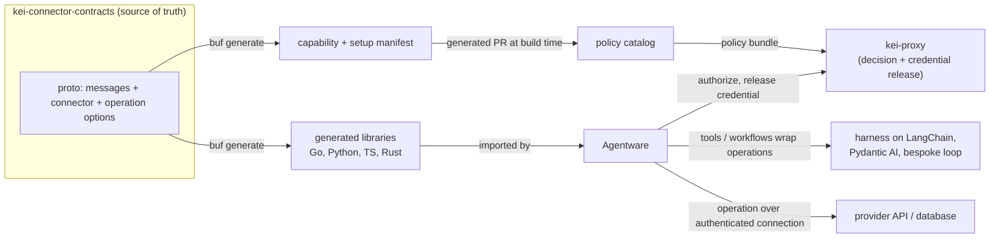
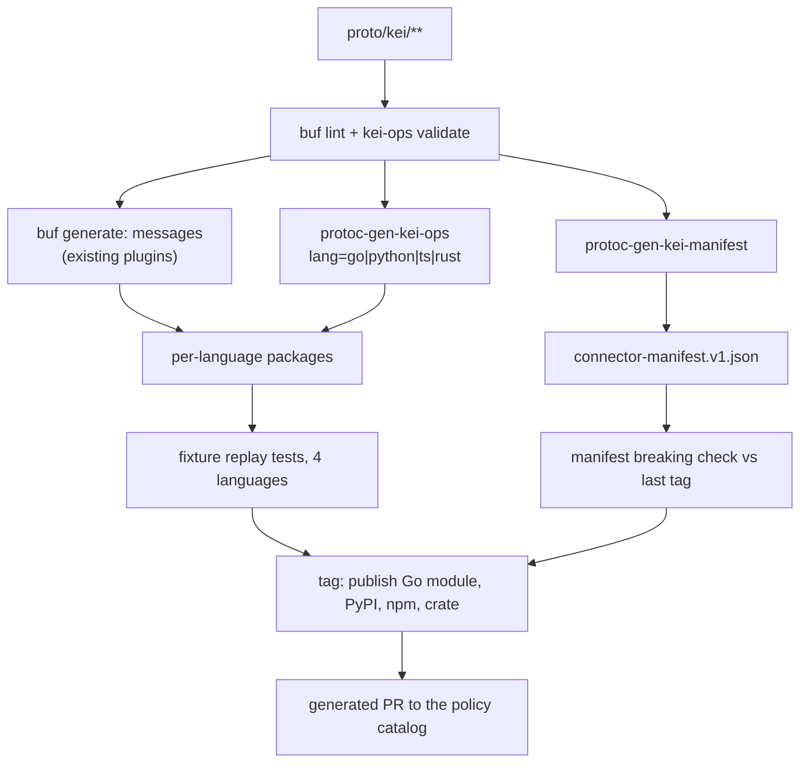
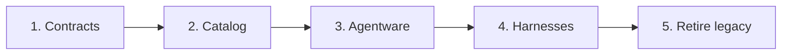

# Proposal 0002: Generated connector operations

**Status:** Draft (2026-11-17).

Supersedes, once accepted:

- in [proposal 0001](0001-operation-contracts.md), the 2026-11-11 amendment's
  "no generated HTTP clients" rule and the open question about who the typed
  layer is for;
- in the 2026-11-15 amendment ("separation of concerns", agent data contracts
  only), the rules that the policy catalog defines governable capabilities and
  that a new connector adds no setup or auth information to this repository.

Everything else in 0001 and its amendments stands: proto is the one contract
language, versions ship in lockstep across Go, Python, TypeScript and Rust,
kei-proxy stays decision-only, and the legacy packages stay frozen.

## 1. Problem

Today a harness that wants to read a GitHub issue or run a database query
writes the HTTP call, the credential placement, the response parsing and the
error handling itself. The contracts in this repository give it the message
types (filled by JSON unmarshal) and an operation option with an id, a method
and a path, but nothing executes them. The result:

- **Every harness re-implements the same calls**, in every language, and they
  drift. A path parameter called `{repo}` in one place and `{repository}` in
  another is a runtime bug nobody catches at build time.
- **Auth is described in prose, not in the contract.** Which credential a
  connection needs (an OAuth token, a DSN, a key-pair JWT), which setup fields
  an admin fills in, and how the credential goes on the wire live in
  [connector-auth.md](../connector-auth.md), the frozen `setup` and `access`
  packages, and the policy catalog's own setup tables. Three copies, three
  owners.
- **Capabilities are defined twice.** The catalog defines the capabilities
  policies grant; this repository defines operation ids. Nothing guarantees
  that the two lists agree, so a policy can grant a capability no code
  performs, and an operation can exist that no policy can name.
- **Tool calls and operations are conflated.** A tool is a model-facing
  wrapper a harness author designs for a framework (LangChain, Pydantic AI, a
  bespoke loop). An operation is a fixed call to a provider API. Policy should
  govern the second, not the first.

## 2. Proposal in one paragraph

A **connector** is a generated library, in the way sqlc generates a `Queries`
type that wraps a `*sql.DB`. It ties together three parts, all declared in
proto in this repository: the **API contract** (request and response
messages), the **connection contract** (what credential a connection needs and
how an authenticated connection is built), and the **operations** (typed
functions such as `GetIssue` over that connection). Operations are the
catalog's **capabilities**, and capabilities are what policies grant. A new
buf plugin generates, per language, the operation interfaces and their
implementations, and a capability and setup **manifest** that the policy
catalog takes in at build time. Agentware imports the generated libraries,
asks kei-proxy to authorize each operation and release its credential, builds
the connection and calls the operation. Tools and workflows wrap operations.



## 3. The three parts

### 3.1 API contract

Unchanged from 0001: one `<Op>Request` and `<Op>Response` message pair per
operation, `json_name` where the provider key differs, filled by JSON
unmarshal of the real payload. Fixtures stay synthetic or sanitized.

### 3.2 Connection contract

A connection contract says how an authenticated connection to a connector is
built. A connector declares one or more **connection kinds**; an operation
names the kinds it works over. Each kind has:

| Field | Meaning |
| --- | --- |
| `name` | Stable name within the connector, for example `user_oauth` or `pat` |
| `kind` | How the connection is built: `HTTP_BEARER`, `HTTP_HEADER`, `HTTP_BASIC`, `SQL_DSN`, `KEY_PAIR_JWT`, `TOKEN_EXCHANGE` |
| `auth_method` | The method in [connector-auth.md](../connector-auth.md): `sso_reuse`, `oauth`, `secret_ref`, `kei_token_exchange`, `service_principal_key` |
| `account_model` | `per_user` or `shared` |
| `base_url` | The fixed provider origin, or the name of the setup field that holds it |
| `setup_fields` | What an admin fills in: name, type, pattern, whether it is secret |
| `scopes` | The provider scopes the credential must carry, if any |

The contract names fields and placements. It never holds a credential value.

### 3.3 Operations

An operation is a named, typed function over a connection. Its definition
extends the existing `kei.contracts.v1.operation` option. It is the unit of
generation, the unit of capability and the unit of policy. It is **not** a tool
call: it has no model-facing description and no model-specific schema.

| Field | Meaning | Today |
| --- | --- | --- |
| `id` | Dotted id, `connector.resource.verb`. Also the capability id | exists |
| `connector`, `class`, `destructive`, `scopes` | As today | exist |
| `http_method`, `path_template` | The HTTP call | exist |
| `credential_placement` | Moves to the connection kind; kept for compatibility | exists |
| `method_name` | Generated function name; defaults to the request message name without `Request` | new |
| `connections` | Connection kinds this operation accepts | new |
| `params` | Where each request field goes (path, query, body, header); defaults: path-template fields go in the path, the rest in the query for `GET` and in the body otherwise | new, as a field option |
| `resource_template` | The policy resource the call touches, for example `repos/{owner}/{repository}` | new |
| `errors` | Provider status to error kind, and whether it is retryable | new |

## 4. Worked example

### 4.1 The proto DSL

A connector file declares the connector and its connection kinds once:

```proto
// proto/kei/connectors/github/v1/connector.proto
syntax = "proto3";
package kei.connectors.github.v1;
import "kei/contracts/v1/options.proto";

option (kei.contracts.v1.connector) = {
  id: "github"
  base_url: "https://api.github.com"
  connections: [
    {
      name: "user_oauth"
      kind: CONNECTION_KIND_HTTP_BEARER
      auth_method: "sso_reuse"
      account_model: ACCOUNT_MODEL_PER_USER
    },
    {
      name: "pat"
      kind: CONNECTION_KIND_HTTP_BEARER
      auth_method: "secret_ref"
      account_model: ACCOUNT_MODEL_SHARED
      setup_fields: [{ name: "token" type: "string" secret: true }]
    }
  ]
};
```

The operation keeps its existing option and gains the new fields:

```proto
// proto/kei/connectors/github/v1/issues.proto
message GetIssueRequest {
  string owner = 1;
  string repository = 2;
  int64 issue_number = 3;

  option (kei.contracts.v1.operation) = {
    id: "github.issues.get"
    connector: "github"
    class: OPERATION_CLASS_READ
    http_method: "GET"
    path_template: "/repos/{owner}/{repository}/issues/{issue_number}"
    scopes: ["issues:read"]
    method_name: "GetIssue"
    connections: ["user_oauth", "pat"]
    resource_template: "repos/{owner}/{repository}"
    errors: [
      { status: 404 kind: ERROR_KIND_NOT_FOUND },
      { status: 429 kind: ERROR_KIND_RATE_LIMITED retryable: true }
    ]
  };
}
```

The database connector uses a DSN connection and no HTTP path:

```proto
// proto/kei/connectors/database/v1/connector.proto
option (kei.contracts.v1.connector) = {
  id: "database"
  connections: [{
    name: "dsn"
    kind: CONNECTION_KIND_SQL_DSN
    auth_method: "secret_ref"
    account_model: ACCOUNT_MODEL_SHARED
    setup_fields: [{ name: "dsn" type: "string" secret: true }]
  }]
};

// proto/kei/connectors/database/v1/query.proto
message RunQueryRequest {
  Dialect dialect = 1;
  string sql = 2;
  repeated google.protobuf.Value params = 3;
  optional int64 max_rows = 4;

  option (kei.contracts.v1.operation) = {
    id: "database.query.run"
    connector: "database"
    class: OPERATION_CLASS_READ
    scopes: ["query:read"]
    method_name: "RunQuery"
    connections: ["dsn"]
    resource_template: "query"
  };
}
```

### 4.2 Generated Go

One package per connector, next to the generated messages. A small,
hand-written `connection` package per language (section 5.2) supplies the
connection types; the generated code only uses them.

```go
package githubops // gen/go/kei/connectors/github/v1/githubops

// Operations is the GitHub connector. Callers depend on it; tests mock it.
type Operations interface {
    GetIssue(ctx context.Context, req *githubv1.GetIssueRequest) (*githubv1.GetIssueResponse, error)
    ListIssues(ctx context.Context, req *githubv1.ListIssuesRequest) (*githubv1.ListIssuesResponse, error)
}

// Queries implements Operations over an authenticated HTTP connection.
type Queries struct{ conn connection.HTTP }

func New(conn connection.HTTP) *Queries

// Operation descriptors, for authorization and audit.
var (
    OpGetIssue   = connection.Op{ID: "github.issues.get", Class: connection.Read}
    OpListIssues = connection.Op{ID: "github.issues.list", Class: connection.Read}
)
```

```go
package databaseops

type Operations interface {
    RunQuery(ctx context.Context, req *databasev1.RunQueryRequest) (*databasev1.RunQueryResponse, error)
}

type Queries struct{ conn connection.SQL } // wraps a *sql.DB, like sqlc

func New(conn connection.SQL) *Queries
```

Each method renders the path from the request, applies the parameter
placement, sends the request on the connection (which already carries the
credential), maps errors by the declared table, and unmarshals the response
with protojson, discarding unknown fields.

### 4.3 Generated Python

```python
# kei_connectors/github/v1/ops.py (generated)
class GitHubOperations(Protocol):
    async def get_issue(self, req: GetIssueRequest) -> GetIssueResponse: ...
    async def list_issues(self, req: ListIssuesRequest) -> ListIssuesResponse: ...

class GitHubQueries(GitHubOperations):
    def __init__(self, conn: HttpConnection) -> None: ...

OP_GET_ISSUE = Op(id="github.issues.get", op_class=OpClass.READ)
```

```python
# kei_connectors/database/v1/ops.py (generated)
class DatabaseQueries:
    def __init__(self, conn: SqlConnection) -> None: ...
    async def run_query(self, req: RunQueryRequest) -> RunQueryResponse: ...
```

TypeScript and Rust follow the same shape from the same templates.

### 4.4 Agentware builds the connection

Connector libraries never call kei-proxy. Agentware does, once per operation
call. The names below (`OperationRunner`, `run`) are **proposed** Agentware
API, not something that exists today.

```mermaid
sequenceDiagram
  participant T as Tool (LangChain / Pydantic AI)
  participant A as Agentware OperationRunner
  participant K as kei-proxy (socket)
  participant L as generated githubops
  participant P as GitHub API
  T->>A: run(caller, OpGetIssue, GetIssueRequest)
  A->>K: authorize(session, target connector:github.issues.get, resource)
  K-->>A: allow (or deny, enrollment, connect)
  A->>K: release credential for the connection kind
  K-->>A: credential (memory only, never logged)
  A->>A: build connection.HTTP (bearer, base URL)
  A->>L: New(conn).GetIssue(ctx, req)
  L->>P: GET /repos/{owner}/{repository}/issues/{n}
  P-->>L: JSON
  L-->>A: GetIssueResponse
  A->>A: audit (operation id, decision, outcome; no payload)
  A-->>T: GetIssueResponse
```

- Authorization uses the existing socket client and `KeiProxyEvaluator`. The
  target is `connector:<operation id>`, which the policy package already
  matches by dot segment (`connector:github.issues.*`).
- Credential release uses the existing
  [credential pass-through](../credential-passthrough.md) route. The runner
  picks the connection kind the installed connector is configured with.
- A deny, an enrollment or a connect decision is returned before any
  connection is built. Fail-closed rules are unchanged.
- For the database connector the runner builds `connection.SQL` from the
  released DSN; it caches the pool per connector and session, and drops it when
  the credential is revoked or the session ends.

### 4.5 A tool wraps the operation

Model-facing text belongs to the harness author. The operation stays the same
whichever framework wraps it.

LangChain:

```python
from langchain_core.tools import tool
from kei_connectors.github.v1 import ops as github_ops
from kei_connectors.github.v1.issues_pb2 import GetIssueRequest

@tool
async def read_issue(owner: str, repository: str, number: int) -> dict:
    """Read one GitHub issue: title, state and body."""
    resp = await runner.run(caller, github_ops.OP_GET_ISSUE,
                            GetIssueRequest(owner=owner, repository=repository,
                                            issue_number=number))
    return {"title": resp.title, "state": resp.state, "body": resp.body}
```

Pydantic AI:

```python
from pydantic_ai import Agent, RunContext
from kei_connectors.database.v1 import ops as db_ops
from kei_connectors.database.v1.query_pb2 import RunQueryRequest, DIALECT_POSTGRES

agent = Agent(model, deps_type=Deps)

@agent.tool
async def sales_by_region(ctx: RunContext[Deps], quarter: str) -> list[list]:
    """Total sales per region for a quarter."""
    resp = await ctx.deps.runner.run(ctx.deps.caller, db_ops.OP_RUN_QUERY,
        RunQueryRequest(dialect=DIALECT_POSTGRES,
                        sql="select region, sum(amount) from sales where quarter = $1 group by 1",
                        params=[quarter], max_rows=100))
    return [list(r.values) for r in resp.rows]
```

Both tools are governed by the operation they call. A policy that permits
`connector:database.query.run` permits `sales_by_region` and any other tool
built on it; a tool built on two operations needs both.

### 4.6 The generated catalog manifest

The manifest plugin emits one deterministic JSON document per release. The
catalog takes it in at build time through a generated pull request; it never
reads this repository at run time.

```json
{
  "schema": "kei.connector-manifest/v1",
  "contracts_version": "v0.19.0",
  "connectors": [
    {
      "id": "github",
      "connections": [
        { "name": "user_oauth", "kind": "http_bearer", "auth_method": "sso_reuse",
          "account_model": "per_user", "setup_fields": [] },
        { "name": "pat", "kind": "http_bearer", "auth_method": "secret_ref",
          "account_model": "shared",
          "setup_fields": [{ "name": "token", "type": "string", "secret": true }] }
      ],
      "capabilities": [
        { "id": "github.issues.get", "class": "read", "destructive": false,
          "scopes": ["issues:read"], "connections": ["user_oauth", "pat"],
          "resource_template": "repos/{owner}/{repository}",
          "request": "kei.connectors.github.v1.GetIssueRequest",
          "response": "kei.connectors.github.v1.GetIssueResponse" }
      ]
    },
    {
      "id": "database",
      "connections": [
        { "name": "dsn", "kind": "sql_dsn", "auth_method": "secret_ref",
          "account_model": "shared",
          "setup_fields": [{ "name": "dsn", "type": "string", "secret": true }] }
      ],
      "capabilities": [
        { "id": "database.query.run", "class": "read", "destructive": false,
          "scopes": ["query:read"], "connections": ["dsn"],
          "resource_template": "query",
          "request": "kei.connectors.database.v1.RunQueryRequest",
          "response": "kei.connectors.database.v1.RunQueryResponse" }
      ]
    }
  ]
}
```

The catalog builds its connector templates, capability list and setup forms
from this document. It still owns everything that is per organization:
connector instances, configured values, policies, grants and tool approvals.

## 5. Generation pipeline



### 5.1 Plugins

- **`protoc-gen-kei-ops`**, one plugin written in Go with a template per
  language, selected by a `lang` parameter. It reads the connector and
  operation options from the descriptors and emits the operations interface,
  the implementation and the operation descriptors.
- **`protoc-gen-kei-manifest`** emits the manifest. It sorts every list so the
  output can be committed and diffed.
- Both run a **validation pass** first and fail the build on: a duplicate
  operation id; a `connector` that does not match the id's first segment; a
  write without a scope; a path-template variable with no request field; a
  `connections` entry the connector does not declare; a missing
  `<Op>Response` message; a secret setup field with a default value.

### 5.2 Hand-written runtime, per language

A small package per language, not generated: the `connection` types
(`HTTP`, `SQL`, and the JWT and token-exchange builders), the `Op`
descriptor, the error kinds and the path renderer. It is the only code the
generated packages import besides the protobuf runtime. It takes credentials as
arguments and never fetches them: it has no kei-proxy client, no secret store
client and no logging of credentials.

### 5.3 Where it ships

The root Go module stays stdlib-only, as today. Generated messages,
generated operations and the runtime package ship in the existing generated
packages (`gen/go` as its own module, and the Python, npm and Rust packages),
all at one version from one tag. A release is blocked unless fixture replay
tests pass in all four languages: each fixture runs against a local test
server (or a test database) through the generated operation.

## 6. Versioning and breaking rules

The capability id is a public name that policies are written against. It is
permanent.

| Change | Rule |
| --- | --- |
| Add an operation, a connector or a connection kind | Additive |
| Add an optional request field or a response field | Additive |
| Add an error mapping | Additive |
| Rename or remove an operation id | Breaking. Add the new id, mark the old one `deprecated`, keep it for at least two minor releases |
| Change `class` from read to write, or set `destructive` | Breaking: policies granted for a read would now cover a write |
| Add a required scope, or remove a connection kind an operation accepts | Breaking: configured connectors would stop working |
| Change the HTTP method, path template or resource template | Breaking |
| Remove or renumber a message field | Breaking (`buf breaking` already catches it) |

`buf breaking` checks the messages. It does not check option values, so the
manifest check compares the new manifest against the last tag's and fails on
any breaking row above. A breaking change takes a `v2` package for that
connector, never an edit in place.

The generated interfaces grow when an operation is added. That is additive for
callers. Code that implements an `Operations` interface outside the generated
package (a mock, for example) may need a new method; the generated packages
ship a mock for each interface so tests do not have to.

## 7. How existing pieces map

| Existing | Becomes |
| --- | --- |
| Pilot operations (GitHub, Linear, `http_api`, database protos and fixtures) | The first generated operations. Their options gain the new fields; their fixtures become replay tests |
| `kei.contracts.v1.operation` option | Extended additively (new field numbers). `credential_placement` moves to the connection kind and is kept for compatibility |
| `setup` package and `schemas/connector-setup.v1.json` (frozen) | Replaced by connection kinds and their `setup_fields`. During the window, the JSON export is generated from the manifest, then retired |
| `access` package and `schemas/connector-access.v1.json` (frozen) | The `api` mode becomes the connection kinds. `cli`, `mcp` and `webhook` modes were never populated and are not carried over |
| `capability` package and the provider registry in `contract` (frozen) | Replaced by the manifest's capabilities |
| `providers` hand-written clients (frozen) | Replaced by generated operations; kept frozen until their consumers move, then removed in a major version |
| `calltemplate` and the `kei.tool-definition/v1` schemas (frozen) | Retired. Tools are defined in Agentware and wrap operations |
| [connector-auth.md](../connector-auth.md) matrix | Its decided rows become connection kinds; the document stays as the place where proposed methods are researched before they become proto |
| Catalog setup tables (the connector template, capability and setup-field rows written during the separation-of-concerns work) | Generated from the manifest through the build-time pull request. Per-org rows stay catalog-owned |
| Tool manifests (`manifest` package, Agentware `KeiScope` and `ExportKeiToolManifest`) | Stay as the harness's tool registration and grant nothing. A tool entry gains the list of operations it calls; authorization moves from the tool name to the operation id (open question 6) |
| MCP (`mcp.<server>.<tool>`) and `builtin.<name>` ids | Unchanged: assigned by the harness at registration, not generated |
| kei-proxy authorize and credential release | Unchanged. Agentware is the only caller in this design |

## 8. Capabilities are operation ids

Owner decision (2026-11-17): **the operation id is the capability.** There is
no second capability name. A policy grants an operation id
(`connector:github.issues.get`) or a dot-segment wildcard
(`connector:github.issues.*`, `connector:github.*`), matched by the existing
policy package with no schema change.

The generated manifest replaces today's coarse catalog capability rows
(`issue.read`, `pull_request.read`, `team.read`, ...). Those rows are per
provider and per verb; one of them stands for several calls, and some stand
for calls no contract defines yet.

### 8.1 One-time grant mapping

Existing policies and grants name the coarse capabilities. They move to
operation ids once, when the catalog first takes in the generated manifest
(phase 2 of the migration plan):

- The mapping is data in this repository: a `legacy_capabilities` table in
  the manifest, from each coarse capability to the operation ids it covers.
  The catalog applies it in one migration and records each rewritten policy
  in its audit log.
- **The mapping never widens a grant.** A coarse capability maps only to
  operations that do what it already allowed. A new kind of access (for
  example the `git.*` write steps) is never granted by the mapping; an admin
  grants it explicitly.
- A coarse capability with no operation yet stays on the policy unchanged. It
  keeps working on the legacy path during the compatibility window and is
  mapped in the release that adds its operations.
- Wildcard targets (`connector:github.*`) need no rewrite.
- After the window, the legacy rows are deleted and the catalog rejects coarse
  capability names on new policies.

Proposed mapping for GitHub and Linear ("missing" means the operation is not
in the contracts yet; see 8.2):

| Coarse capability | Operation ids |
| --- | --- |
| GitHub `issue.read` | `github.issues.get`, `github.issues.list` |
| GitHub `pull_request.read` | `github.pulls.get`, `github.pulls.list` (missing), `github.pulls.reviews.list` (missing) |
| GitHub `workflow.read` | `github.actions.runs.list` (missing) |
| GitHub `issue.create` | `github.issues.create` (missing) |
| GitHub `issue.comment` | `github.issues.comments.create` (missing) |
| GitHub `pull_request.create` | `github.pulls.create` (missing) |
| GitHub `pull_request.update` | `github.pulls.update` (missing) |
| GitHub `repository.read`, `check.read`, `issue.update` | none yet; kept until operations exist |
| Linear `issue.read` | `linear.issues.get`, `linear.issues.search` |
| Linear `issue.create` | `linear.issues.create` |
| Linear `team.read` | `linear.teams.get` (missing) |
| Linear `comment.create` | `linear.comments.create` (missing) |
| Linear `project.read`, `cycle.read`, `issue.update` | none yet; kept until operations exist |

Operations with no coarse equivalent start ungranted: `github.contents.put`,
`github.pulls.reviews.create` and the `github.git.*` steps.

### 8.2 Missing operations

Aligning a chat harness's hand-written GitHub and Linear calls with the
contracts found these gaps. Each becomes a proto operation (and fixtures)
before the harness can move to generated code:

| Connector | Operation id | Class | Notes |
| --- | --- | --- | --- |
| GitHub | `github.pulls.list` | read | |
| GitHub | `github.actions.runs.list` | read | workflow runs for a repository |
| GitHub | `github.issues.create` | write | |
| GitHub | `github.pulls.create` | write | |
| GitHub | `github.pulls.update` | write | |
| GitHub | `github.pulls.reviews.list`, `github.pulls.reviews.create` | read, write | |
| GitHub | `github.issues.comments.create` | write | |
| GitHub | `github.git.*` | write | the Git data steps a harness uses to commit to a branch: get and create refs, create blobs, trees and commits, update a ref. One operation per step, so each is granted on its own |
| Linear | `linear.teams.get` | read | |
| Linear | `linear.comments.create` | write | |

Missing response fields (additive, no new operation):

- `user.login` (the author) on GitHub issue and pull request responses;
- `labels` on GitHub issue and pull request responses, and on Linear issues;
- branch refs (`head.ref`, `base.ref`) on GitHub pull request responses.

## 9. Migration plan

The rollout order is fixed (owner, 2026-11-17): **contracts, then catalog,
then Agentware, then harnesses.** Each phase starts only when the previous
phase's gate is met, and nothing a consumer uses today breaks until phase 5.



### Phase 1: contracts

Deliverables:

- The `connector` file option, the new `operation` fields and the parameter
  field option in `options.proto`, added additively.
- The pilot operations annotated with connection kinds, resource templates
  and errors, and the missing operations and response fields in section 8.2,
  each with fixtures.
- `protoc-gen-kei-ops` with templates for Go, Python, TypeScript and Rust,
  and the hand-written `connection` runtime package per language.
- `protoc-gen-kei-manifest`, the `legacy_capabilities` mapping table, the
  validation pass, fixture replay tests in all four languages and the
  manifest breaking check.
- A tagged release that publishes the generated packages and the manifest.

Gate to phase 2: a tagged release whose manifest passes validation and covers
every operation in section 8.2, and whose generated packages pass fixture
replay in all four languages.

Compatible meanwhile: everything. The generated message types and their JSON
unmarshal are unchanged, the legacy packages keep working, and no service
reads the manifest yet.

### Phase 2: catalog

Deliverables:

- The release workflow opens a generated pull request in the policy catalog
  for each contracts release. The catalog builds its connector templates,
  capability list and setup forms from the manifest at build time; it never
  reads this repository at run time.
- The one-time migration of section 8.1: existing grants rewritten from
  coarse capabilities to operation ids, recorded in the audit log, never
  widened.
- Policy bundles carry operation-id targets (`connector:github.issues.get`).
- The `setup` and `access` JSON exports, where still consumed, generated from
  the manifest.

Gate to phase 3: the catalog is deployed with manifest-built templates, the
grant migration has run, and an issued bundle authorizes an operation id
through `kei-proxy` in a test installation.

Compatible meanwhile: coarse capability names that have no operation yet stay
on their policies, and bundles keep authorizing today's tool-name calls, so
existing harnesses are unaffected.

### Phase 3: Agentware

Deliverables:

- Agentware imports the generated libraries in Go, Python and TypeScript (and
  Rust when Agentware has a Rust port).
- The operation runner: authorize the operation id over the `kei-proxy`
  socket, release the credential, build the connection for the configured
  connection kind, call the operation, audit. Fail-closed rules unchanged.
- Framework adapters that turn an operation into a tool: LangChain and
  Pydantic AI first, plus the bespoke-loop tool registry. The adapter takes
  model-facing text from the harness author.
- Tool manifests list the operations each tool calls.

Gate to phase 4: an Agentware release whose runner passes the shared
authorize fixtures and an end-to-end test (allow, deny, enrollment, connect,
revoked credential) against a real `kei-proxy` in all its ports, with both
framework adapters published.

Compatible meanwhile: the existing `KeiProxyEvaluator`, tool-name
authorization, `KeiScope` and tool manifest export keep working unchanged;
the runner is new API beside them.

### Phase 4: harnesses

Deliverables:

- Pedro, Haikei's own harness, first: its GitHub stack (hand-written `gh`
  and API calls, including the branch, commit and pull request steps) is
  reworked onto Agentware operations, and the hand-written code is deleted.
- Then the other harnesses, one at a time, each deleting its hand-written
  provider calls as it moves.

Gate to phase 5: no supported harness calls a provider API by hand for a
connector that has generated operations, and no consumer imports the legacy
packages.

Compatible meanwhile: a harness that has not moved keeps using its own calls
and tool-name authorization; the catalog and kei-proxy serve both.

### Phase 5: retire the legacy packages

`providers`, `setup`, `access`, `capability`, `calltemplate`, the provider
registry and the coarse capability rows are removed in one major version.

### Later, optional: customer-defined connectors

A small builder API per language that lets a customer declare a connector,
its connection kinds and its operations in code, and emits the same manifest
shape under a reserved id prefix. The catalog takes it in through the same
import path.

## 10. Risks

- **Four generators and four runtimes.** The templates are small, but every
  language is maintained in lockstep. Mitigation: one plugin, shared
  fixtures, and one replay gate for all four languages.
- **Provider shapes that do not fit an HTTP path.** GraphQL (Linear) and SQL
  need their own transport fields; pagination needs a convention.
- **Generated code now executes provider calls.** The 0001 amendment ruled
  that out. The difference is that the generated code runs inside the harness
  process with a connection the harness built; nothing is relayed through
  kei-proxy, and kei-proxy stays decision-only.
- **A second source of capabilities during the window.** Until phase 2 the
  catalog still has hand-written capability rows. The manifest diff in the
  generated pull request is the check.
- **The grant mapping is a one-way rewrite.** A wrong row narrows or widens
  real access. Mitigation: the mapping never widens, it ships as reviewed
  data in the manifest, and the catalog records every rewritten policy.

## 11. Open questions

1. **Request message or positional arguments?** sqlc generates
   `GetIssue(ctx, owner, repo, n)`. A positional signature breaks every caller
   when a parameter is added. Recommendation: take the request message, and
   consider positional helpers only for operations with one or two required
   fields.
2. **Database connector id.** The catalog template is `postgres`; the
   operation is `database.query.run` with a dialect. Keep one generic
   `database` connector with dialect as a parameter, or generate
   `postgres.query.run`, `mysql.query.run` and so on? Recommendation: one
   generic connector, with the engine as a connection-kind property so the
   catalog can still show "Postgres".
3. **Is a capability always exactly one operation?** Decided (owner,
   2026-11-17): yes, the operation id is the capability (section 8). A policy
   that wants "read issues" uses `connector:github.issues.*`.
4. **GraphQL.** Linear needs the query document as an option rather than a
   path. Is the document generated from the response message, or written by
   hand and checked against the schema in CI?
5. **Pagination.** Generated iterators, or one page per call with the cursor
   in the request?
6. **Authorize by tool name or by operation id?** Today a harness authorizes
   by tool name and the catalog resolves resources. Under this proposal the
   runner authorizes each operation, with the resource rendered from
   `resource_template`. Does the authorize request keep the tool name for
   audit, and does tool-name authorization go away?
7. **Resource grammar.** Is `resource_template` the same grammar as the
   resource patterns policies use today, and who renders it: the runner or
   kei-proxy?
8. **Where the catalog pull request lands** and who approves it: the catalog
   maintainers, or an automated merge when the manifest diff is additive only?
9. **Customer-defined connector ids** (the optional later phase): a reserved
   prefix such as `custom.<org>.`, and whether those connectors can use every
   connection kind.

## 12. The strongest argument against

Generated code that executes calls is a bigger surface to maintain than
generated types that harnesses fill themselves, and most of today's value
(uniform policy targets, one list of capabilities) could come from the
manifest alone. Mitigation: the catalog phase depends only on the manifest,
so it pays off even if the generated code does not. If moving Pedro in
phase 4 does not delete hand-written provider code, stop adding generated
execution code and keep the manifest.
